# 1-1 空間概念

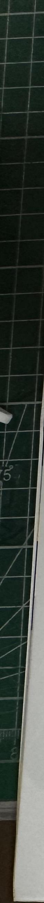

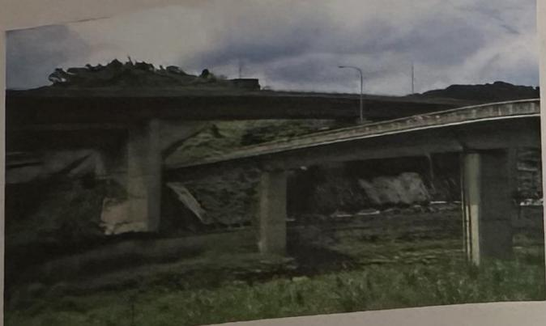

我們生活在立體空間中，有些熟悉的平面幾何性質在空間中變得不同，例如平面上相異兩直線會保持平行或交於一點。那麼，右圖立體交叉的道路設計，代表何種關係？本節中我們將討論生活中建立起的空間直觀概念，以利後續空間坐標的建立。

## 1 空間中直線與直線的關係

由於點、線、面是空間中的重要幾何物件，需要先對它們進行簡要說明。空間中的點、線、面都是未定義概念，下面的基本事實（公設）說明它們之間的關係。

公設 1. 相異兩點決定唯一直線。
公設 2. 不共線三點決定唯一平面。
公設 3. 一平面上相異兩點所決定的直線會落在此平面上。

由前述的基本事實知道：不共線三點決定唯一平面。生活中最好例子就是三腳架，為何三隻腳的支點能平穩站立？因為恰好有一個平面會通過這不共線的三點。

事實上，空間中決定唯一平面的情形還有以下三種。

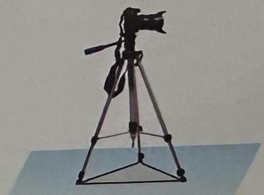

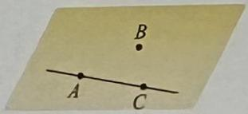
圖 1　一直線及不在此直線上的一點

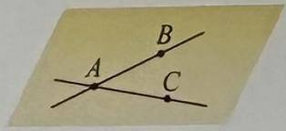
圖 2　恰交於一點的相異兩直線

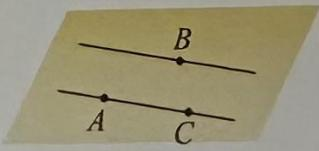
圖 3　兩平行直線

其中圖 1 與圖 2 的情形可由前述基本事實推得。以下說明「恰交於一點的相異兩直線」的情形。

除了兩直線的交點 $A$ 外，我們可在各直線中另取異於交點的點 $B$ 和點 $C$，這構成不共線的三點，可決定唯一平面（公設 2）；因為此平面包含各直線中的相異兩點，所以也包含這兩條直線（公設 3）。

至於「一直線及不在此直線上的一點」如何決定一平面，就由同學自行嘗試。此外，兩平行直線的定義為「相同平面上不相交的兩直線」，因此「兩平行直線」決定一平面顯然成立。我們將上述的討論寫成下面結論。

### 空間中決定平面的條件

(1) 不共線的三點。
(2) 一直線及不在此直線上的一點。
(3) 恰交於一點的相異兩直線。
(4) 兩平行直線。

注意的是，空間中的直線和平面都會無限延伸，本文圖示以線段來表示直線；以平行四邊形來表示平面。並以平行四邊形和線段呈現長方體，以利同學建構空間概念。此外，我們將不共線的三點 $A, B, C$ 所決定的唯一平面記為「平面 $ABC$」，有時也簡稱為「平面 $E$」（如同將相異兩點 $A, B$ 所決定的唯一直線記為直線 $AB$，有時也簡稱直線 $L$）。

### 教學活動

如右圖，$A, B, C, D, E, F, G, H$ 為正立方體的八個頂點，試問下列哪些線段會與 $\overline{BE}$ 共平面？（多選）

(A) $\overline{BG}$　(B) $\overline{AC}$　(C) $\overline{DF}$　(D) $\overline{DH}$　(E) $\overline{CH}$

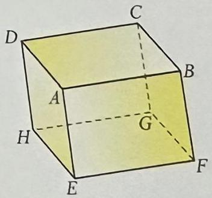

接下來，我們介紹空間中兩條相異直線的關係。右圖是大家最熟知的長方體，可以輔以觀察兩條稜邊所在直線的關係。

(1) **當兩相異直線共面時**，由上述可知，這兩個直線的關係為平行（如右圖中的 $L_1$ 與 $L_2$，此時以 $L_1 /\!/ L_2$ 表示）或恰交於一點（如右圖中的 $L_2$ 與 $L_3$）。特別的是，當恰交於一點的兩條直線夾角為 $90^\circ$，我們稱兩直線**垂直**，如右圖中的 $L_2$ 與 $L_3$，此時以 $L_2 \perp L_3$ 表示。

(2) **兩相異直線不共面時**，如 $L_1$ 與 $L_3$，此時稱 $L_1$ 與 $L_3$ 為**歪斜線**，或稱兩直線**歪斜**。由於 $L_1$ 與 $L_3$ 不共平面，由前述決定平面的條件可知，$L_1$ 與 $L_3$ 既不平行，也不相交。生活中為了便利通行，會讓一些路線在不同平面上交叉穿越，如捷運的路軌、高速公路的交流道等，都是歪斜線的應用。

### 教學活動

如右圖，長方體 $ABCD\text{-}EFGH$ 中，請分別回答下列問題。

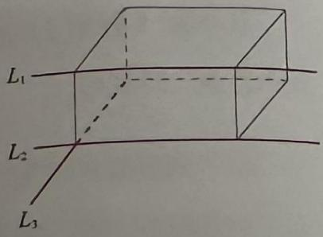

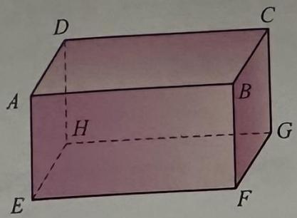

(1) 與稜 $\overline{AB}$ 互相平行的稜有哪些？
(2) 與稜 $\overline{AB}$ 互相垂直的稜有哪些？
(3) 與稜 $\overline{AB}$ 互相歪斜的稜有哪些？

## 2 空間中直線與平面的關係

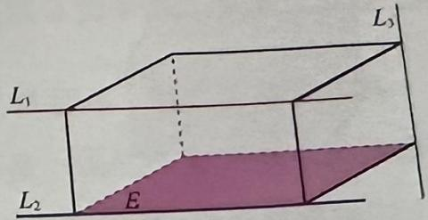

再次觀察右圖的長方體，稜邊所在的直線 $L_1, L_2, L_3$ 與底面所在的平面 $E$ 的關係為何？若從直線與平面的交點個數來看，可知以下關係。

(1) 沒有交點：例如 $L_1$ 與 $E$ 的關係，此時稱直線 $L_1$ 與平面 $E$ 平行，可表示為 $L_1 /\!/ E$。
(2) 交於一點：例如 $L_3$ 與 $E$ 的關係。
(3) 無限多個交點：例如 $L_2$ 與 $E$ 的關係，此時稱 $L_2$ 完全落在 $E$ 上。

我們知道兩直線 $L$ 與 $M$ 交於一點且夾角為 $90^\circ$ 時，稱此兩直線垂直（記為 $L \perp M$）。那麼，直線 $L$ 與平面 $E$ 交於一點時，如何定義直線 $L$ 與平面 $E$ 垂直呢？

國中時已經知道下面性質：如右圖，長方體的**稜邊 $\overline{DE}$ 垂直底面** $ABCD$，在 $\overline{AC}$ 上任取一點 $M$，則 $\overline{DE} \perp \overline{DM}$。我們正式將它寫成直線與平面垂直的定義。

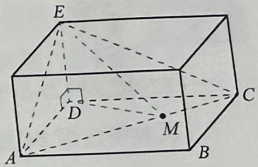

### 直線與平面垂直的定義

若直線 $L$ 和平面 $E$ 相交於 $P$ 點，平面 $E$ 上通過 $P$ 點的每一條直線都和 $L$ 垂直，則稱直線 $L$ **垂直**平面 $E$，以 $L \perp E$ 表示，此時直線 $L$ 稱為平面 $E$ 的**法線**或**垂線**。

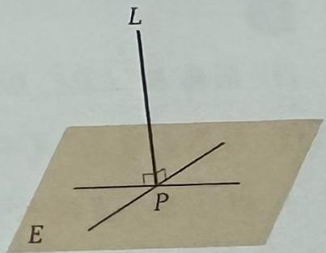

不過，根據上述的定義，必須檢驗平面 $E$ 上過 $P$ 點的**每一條**直線是否與 $L$ 垂直，因此比較難判斷平面 $E$ 與直線 $L$ 是否垂直。

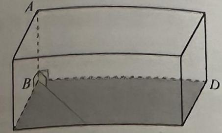

再次觀察長方體，平面 $BCD$ 的垂線段稜邊 $\overline{AB}$ 同時垂直另兩條稜邊 $\overline{BC}$、$\overline{BD}$，是不是只要直線垂直平面上的兩相異直線，就能知道此直線垂直該平面呢？

事實上，只需檢驗過 $P$ 點的兩條相異直線是否和 $L$ 垂直即可。我們將此結果敘述如下，至於證明則放在書末附錄一。

### 直線與平面垂直的判別方法（法線定理）

設直線 $L$ 與平面 $E$ 相交於 $P$ 點，在平面 $E$ 上，若有通過 $P$ 點的兩條相異直線 $L_1$ 與 $L_2$ 都和 $L$ 垂直，則直線 $L$ 與平面 $E$ 垂直。

### 例題 1

一長方體 $ABCD\text{-}EFGH$，如右圖所示，已知 $\overline{AB}=6$，$\overline{AD}=3$，$\overline{AE}=2$。

(1) 試說明直線 $BF$ 垂直平面 $ABC$。
(2) 試說明直線 $BF$ 垂直直線 $BD$。
(3) 求 $\overline{DF}$ 的長。

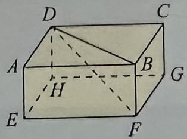

**解**

(1) 因為 $\overline{BF} \perp \overline{BA}$，$\overline{BF} \perp \overline{BC}$，所以直線 $BF$ 垂直平面 $ABC$。

(2) 因為直線 $BD$ 是平面 $ABC$ 上的一直線，由 (1) 知，直線 $BF$ 垂直平面 $ABC$，故直線 $BF$ 垂直直線 $BD$。

(3) 由於 $\angle DAB = 90^\circ$，所以 $\overline{BD} = \sqrt{\overline{AB}^2 + \overline{AD}^2} = \sqrt{6^2 + 3^2} = \sqrt{45}$，
由 (2) 知，直線 $BF$ 垂直直線 $BD$ 且 $\overline{BF} = \overline{AE} = 2$，
所以 $\overline{DF} = \sqrt{\overline{BF}^2 + \overline{BD}^2} = \sqrt{2^2 + (\sqrt{45})^2} = \sqrt{49} = 7$。

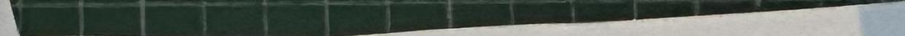

### 隨堂練習

如右圖，給定一個長方體，已知 $\overline{AB}=8$，$\overline{BC}=3$，$\overline{CE}=12$ 且 $P$ 點為 $\overline{AB}$ 上的中點，求 $\overline{PE}$ 的長。

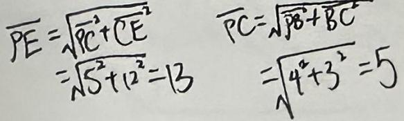

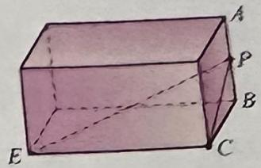

接下來，若直線 $L$ 不垂直平面 $E$ 且交於一點 $P$，該如何決定它們的夾角？這個問題在古人製作日晷時是非常重要的關鍵，如右圖所示，晷針與晷面所夾的角度恰為紅線（晷針）與黑線（晷針投影在晷面的直線）的夾角。在寫出直線與平面夾角的定義之前，先來定義投影點：空間中，過 $A$ 點作直線 $L$ 的垂線交 $L$ 於 $B$ 點，我們稱 $B$ 點為 **$A$ 點在直線 $L$ 上的投影點**；同樣地，過 $A$ 點作平面 $E$ 的垂線交 $E$ 於 $A'$ 點，我們稱 $A'$ 點為 **$A$ 點在平面 $E$ 上的投影點**，如下圖所示。

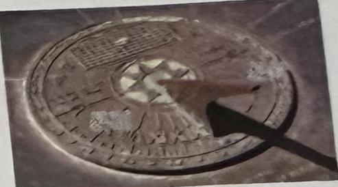
▲ 依日晷所在緯度，晷針和晷面需夾一固定角度

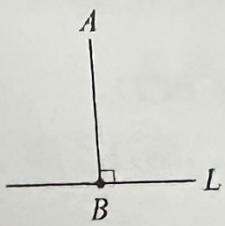

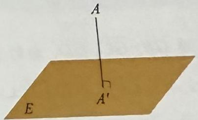

接下來，可以寫出直線與平面夾角的定義。

### 直線與平面的夾角

當直線 $L$ 不垂直平面 $E$ 且交於一點 $P$ 時，$L$ 的所有點在 $E$ 上的投影點，形成 $E$ 上通過 $P$ 的一條直線 $L'$（稱為 $L$ 在 $E$ 上的投影直線），則 $L$ 與 $E$ 的夾角是指 $L$ 與 $L'$ 的夾角，即在圖中的 $\theta_1$ 與 $\theta_2$。

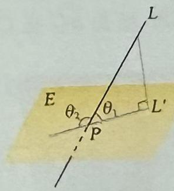

由定義可以看出來，直線與平面夾角會有兩個，且這兩個角互為補角。
當直線 $L$ 垂直平面 $E$ 時，直接定義直線 $L$ 與平面 $E$ 的夾角為直角。

### 教學活動

如右圖，直線 $BF$ 垂直平面 $CDEF$，下列哪個選項代表直線 $BD$ 和平面 $CDEF$ 的一個夾角？

(A) $\angle BDC$　(B) $\angle BDE$　(C) $\angle BDF$　(D) $\angle BCD$　(E) $\angle BCF$

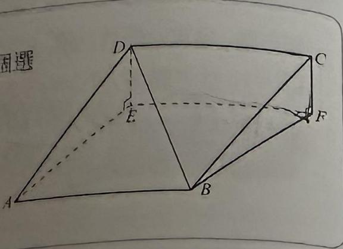

此外，應用直線與平面垂直的定義，可以求得像是正四面體（由四個正三角形所組成的立體圖形）這類常見立體圖形的高。

### 例題 2

設正四面體 $ABCD$ 的稜長為 10，且 $A$ 點在底面 $BCD$ 的投影點為 $G$。

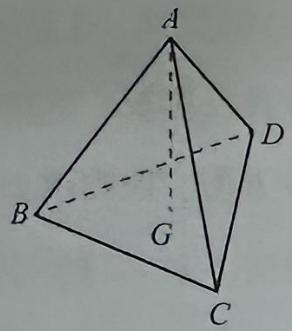

(1) 試證：$G$ 為 $\triangle BCD$ 的外心。
(2) 試求此四面體的高 $\overline{AG}$。

**解**

(1) 如右圖，連 $\overline{GB}$，$\overline{GC}$，$\overline{GD}$，由於直線 $AG \perp$ 平面 $BCD$，
所以 $\overline{GB} \perp \overline{AG}$，$\overline{GC} \perp \overline{AG}$，$\overline{GD} \perp \overline{AG}$。
又 $\overline{AB} = \overline{AC} = \overline{AD} = 10$，
則 $\overline{GB} = \overline{GC} = \overline{GD} = \sqrt{10^2 - \overline{AG}^2}$，
故 $G$ 是 $\triangle BCD$ 的外心。
（旁註：因為 $\triangle BCD$ 為正三角形，故 $G$ 也是 $\triangle BCD$ 的重心。）

(2) 延長 $\overline{BG}$ 交 $\overline{CD}$ 於 $E$ 點，由 (1) 知，$G$ 是 $\triangle BCD$ 的重心，
因此 $E$ 為 $\overline{CD}$ 的中點，且 $\overline{BG} = \frac{2}{3}\overline{BE}$，
$\overline{BE} = \sqrt{\overline{BC}^2 - \overline{CE}^2} = \sqrt{10^2 - 5^2} = 5\sqrt{3}$，
所以 $\sqrt{100 - \overline{AG}^2} = \frac{2}{3} \times 5\sqrt{3}$，推得 $\overline{AG}^2 = 100 - \frac{4}{9} \times 75 = \frac{600}{9}$，
可得 $\overline{AG} = \frac{10\sqrt{6}}{3}$，故此四面體的高 $\overline{AG}$ 為 $\frac{10\sqrt{6}}{3} \approx 8.16$。

### 隨堂練習

右圖為一四角錐，已知其底面是邊長 10 公分的正方形，四個側面均為腰長 13 公分的等腰三角形。$H$ 為頂點 $A$ 在底面 $BCDE$ 的投影點，求此四角錐高 $\overline{AH}$ 的值。

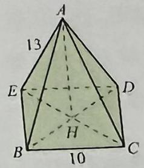

## 3 空間中平面與平面的關係

空間中兩平面有以下三種關係。

(1) 兩平面不相交：如下左圖長方體中的 $E_1$ 與 $E_2$，此時稱 $E_1$ 與 $E_2$ 平行，以 $E_1 /\!/ E_2$ 表示。
(2) 兩平面交於一直線：如下左圖長方體中的 $E_1$ 與 $E_3$ 交於直線 $L$，此時 $L$ 稱為 $E_1$ 與 $E_3$ 的交線。
(3) 兩平面重合，如下右圖。

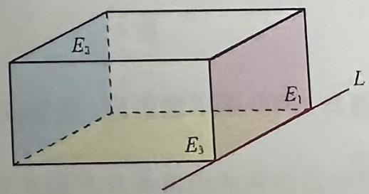

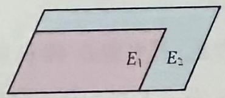

當我們打開一扇門，門板與門軸所在的那面牆之間會構成一個交角（如右圖）。因此相交於一直線的兩平面，它們的夾角如何測量，值得我們討論。

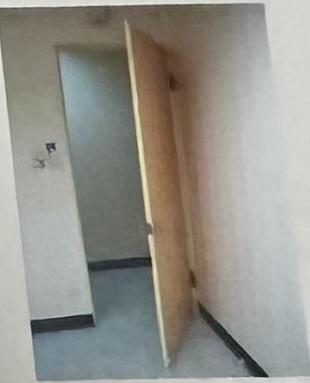

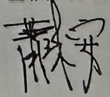

事實上，當兩相異平面 $E_1$ 與 $E_2$ 交於直線 $L$ 時，以 $L$ 為界線可以截取如下圖 7 的圖形，此圖形稱為 $E_1$ 與 $E_2$ 的一個**兩面角**。這個兩面角是由兩個半平面（$E_1'$ 與 $E_2'$）及直線 $L$ 所組成，我們稱直線 $L$ 為此兩面角的**稜**，兩個半平面為此兩面角的**面**。

測量兩面角大小的作法如下：在兩面角的稜 $L$ 上任取一點 $P$，並在兩面角的兩個面上分別作射線 $PQ$ 和 $PR$，使它們都與直線 $L$ 垂直，如下圖 8 所示，此時 $\angle QPR$ 的大小即為此兩面角的大小。由於當 $P$ 點沿著直線 $L$ 上移動時，$\angle QPR$ 的兩邊也隨著平行移動，因此 $\angle QPR$ 的大小不變，故此兩面角的大小與 $P$ 點的選取位置無關。往後我們就以「兩面角」直接代表「兩面角的大小」。

注意的是，交於一直線的兩平面包含四個兩面角，它們之間的角度大小可能相等或互為補角，如下圖 9。

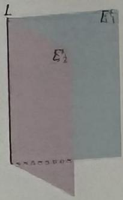
圖 7

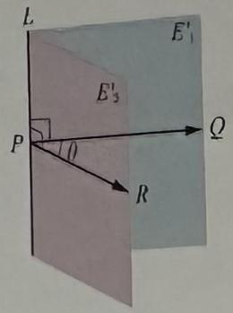
圖 8

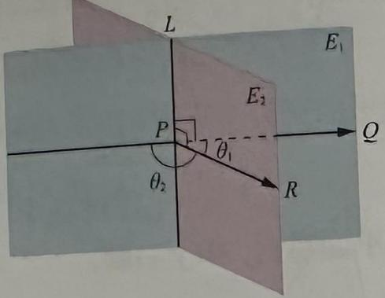
圖 9

特別的是，若平面 $E_1$ 與 $E_2$ 的夾角為**直角**，稱此**兩平面垂直**，記為 $E_1 \perp E_2$。例如長方體中，任何相鄰的兩面都是互相垂直。

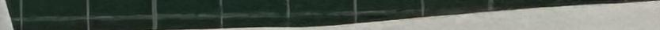

### 例題 3

右圖為正四面體 $A\text{-}BCD$，設側面 $ABC$ 與底面 $BCD$ 所夾的兩面角大小為 $\theta$，試求 $\cos\theta$ 的值，並用計算機求出 $\theta$ 的近似值，以度度量表示求至小數點後第二位。

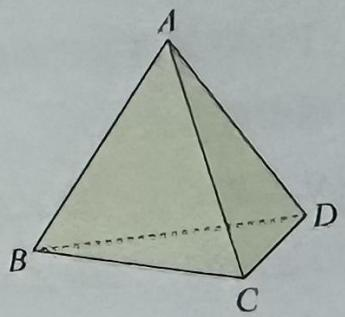

**解**

因為 $\overline{BC}$ 為側面 $ABC$ 與底面 $BCD$ 的交線段，
取 $\overline{BC}$ 的中點 $M$，因為 $\triangle ABC$ 與 $\triangle BCD$ 均為正三角形，
所以 $\overline{AM} \perp \overline{BC}$ 且 $\overline{DM} \perp \overline{BC}$。
根據兩面角的定義，可知 $\angle AMD$ 為側面 $ABC$ 與底面 $BCD$ 所夾的兩面角，即 $\angle AMD = \theta$。
令正四面體 $A\text{-}BCD$ 的稜長為 $a$，
在 $\triangle AMD$ 中，利用餘弦定理：
$\overline{AD}^2 = \overline{AM}^2 + \overline{DM}^2 - 2 \times \overline{AM} \times \overline{DM} \times \cos\theta$，
而 $\overline{AM} = \overline{DM} = \frac{\sqrt{3}}{2}a$（因為 $\overline{AM}$，$\overline{DM}$ 均為正三角形的高），
$a^2 = (\frac{\sqrt{3}}{2}a)^2 + (\frac{\sqrt{3}}{2}a)^2 - 2 \times \frac{\sqrt{3}}{2}a \times \frac{\sqrt{3}}{2}a \times \cos\theta$，
解得 $\cos\theta = \frac{1}{3}$。
利用計算機可以算出兩面角的近似值
$\theta = \cos^{-1}\frac{1}{3} \approx 70.53^\circ$。

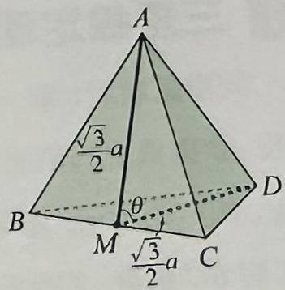

### 隨堂練習

右圖為四面體 $A\text{-}BCD$，若 $\overline{AD} \perp \overline{DB}$，$\overline{AD} \perp \overline{DC}$。下列哪個選項代表側面 $ABD$ 與 $ACD$ 所成一個兩面角的大小？

(A) $\angle BAC$　(B) $\angle BDC$　(C) $\angle ABC$　(D) $\angle ACB$

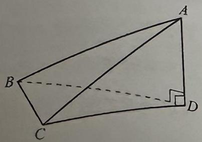

## 4 三垂線定理

同學試看看：拿一個直角三角板 $ABC$，使其一股 $\overline{AB}$ 與桌上的紙面垂直，另一股 $\overline{BC}$ 置於紙面上，如右圖所示。如果在紙面上過 $C$ 點畫一直線 $L$ 與 $\overline{BC}$ 垂直，觀察斜邊 $\overline{AC}$ 是否也會垂直 $L$？這就是下面要討論的三垂線定理。

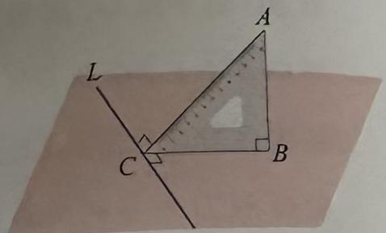

### 三垂線定理

設直線 $AB$ 垂直平面 $E$ 於 $B$ 點，若在平面 $E$ 上，直線 $BC$ 垂直直線 $L$ 於 $C$ 點，則直線 $AC$ 必垂直 $L$ 於 $C$ 點。

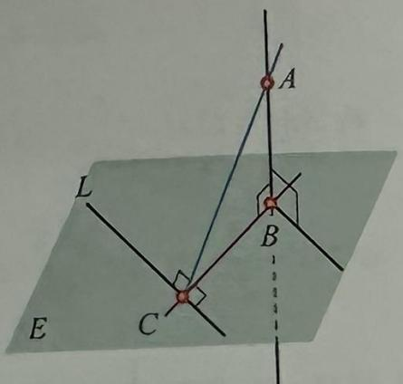
圖 10

【證明】

如右圖，在 $L$ 上取異於 $C$ 的一點 $D$ 使得 $\overline{AB} = \overline{DC}$，連接 $\overline{AD}$ 與 $\overline{BD}$。首先，因為 $\overline{AB} = \overline{DC}$，$\angle ABC = 90^\circ = \angle DCB$，$\overline{BC} = \overline{CB}$，由 SAS 性質可知 $\triangle ABC \cong \triangle DCB$，而有 $\overline{AC} = \overline{DB}$。再因為 $\overline{AC} = \overline{DB}$，$\overline{CD} = \overline{BA}$，$\overline{DA} = \overline{AD}$，由 SSS 性質可知 $\triangle ACD \cong \triangle DBA$，而有 $\angle ACD = \angle DBA = 90^\circ$。

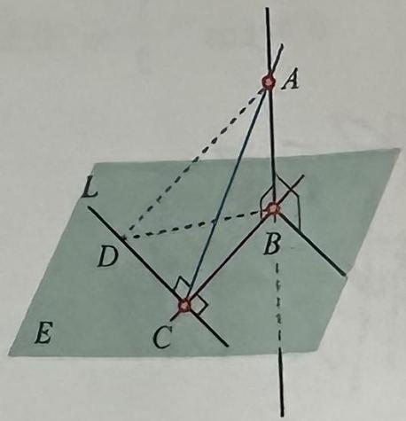

### 例題 4

如右圖，已知直線 $OA$ 垂直平面 $E$ 於 $A$ 點，$L$ 為平面 $E$ 上的一條直線，直線 $AB$ 垂直 $L$ 於 $B$ 點，且 $C$ 為 $L$ 上一點。若 $\overline{OA}=4$，$\overline{AB}=3$，$\angle BOC = 30^\circ$，求 $\overline{BC}$ 的長。

**解**

由於直線 $OA$ 垂直平面 $E$ 於 $A$ 點，所以 $\overline{OA} \perp \overline{AB}$，
因此 $\overline{OB} = \sqrt{\overline{OA}^2 + \overline{AB}^2} = \sqrt{4^2 + 3^2} = 5$。
因為 $\overline{AB} \perp L$，由三垂線定理知 $\overline{OB} \perp L$。
由於 $\frac{\overline{BC}}{\overline{OB}} = \tan\angle BOC = \tan 30^\circ = \frac{1}{\sqrt{3}}$，
所以 $\overline{BC} = \frac{5}{\sqrt{3}} = \frac{5\sqrt{3}}{3}$。

### 隨堂練習

如右圖，已知直線 $AP$ 與平面 $E$ 垂直於 $P$ 點，$L$ 為平面 $E$ 上的一條直線，直線 $PQ$ 與直線 $L$ 垂直於 $Q$ 點。若 $\overline{AP}=6$，$\overline{PQ}=6\sqrt{3}$，且 $\overline{AB}=13$，求 $\overline{QB}$ 的長。

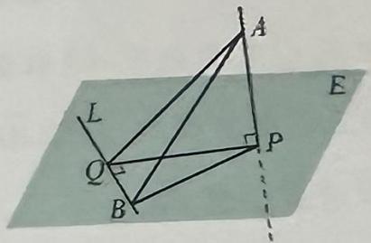

### 教學活動

右圖為一長方體，試問 $\overline{PA}$，$\overline{PB}$，$\overline{PC}$ 會分別垂直 $\overline{OA}$，$\overline{OB}$，$\overline{OC}$ 嗎？

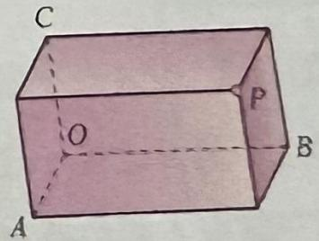

再次細看上述定理的內容，涉及三個關鍵**垂直**：直線 $AB$ 垂直平面 $E$；直線 $BC$ 垂直直線 $L$；直線 $AC$ 垂直直線 $L$，因此稱為**三垂線定理**。觀察圖 10（P. 12），根據三垂線定理，我們知道 $\overline{AC} \perp L$，所以 $C$ 為 $A$ 在直線 $L$ 上的投影點，故 $\overline{AC}$ 是 $A$ 點與直線 $L$ 上任一點的距離中的最短距離。

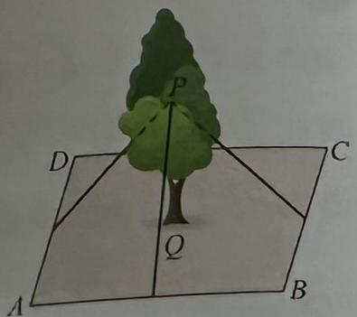

### 例題 5

因應防颱準備，需要固定樹木。已知樹木恰位於一邊長為 16 公尺的正方形花圃 $ABCD$ 的中心 $Q$，且垂直生長於地面。若由樹上離地面 6 公尺處的 $P$ 點往正方形花圃的 4 條邊線上分別各拉 1 條等長的繩子來支撐樹木，如右圖，則這 4 條繩子應如何拉設，才能使繩子的所需總長度最短？並求繩子的最短總長度。

**解**

如右圖，欲使繩子總長度最短，則考慮選取四邊上的點，使點 $P$ 連接各邊的長度最短。
故從 $Q$ 點對線段 $\overline{AB}$ 做垂線 $\overline{QR}$ 交於中點 $R$，
由三垂線定理知，$\overline{PR} \perp \overline{AB}$，即點 $P$ 到線段 $\overline{AB}$ 有最小值 $\overline{PR}$。
因此四條繩子應由點 $P$ 拉至四邊形 $ABCD$ 各邊中點，則所需繩子的長度最短，故總長度也會最短。
因為 $\triangle PQR$ 為直角三角形，所以 $\overline{PR} = \sqrt{\overline{PQ}^2 + \overline{QR}^2} = \sqrt{6^2 + 8^2} = 10$，
故四條繩子總長最短為 40 公尺。

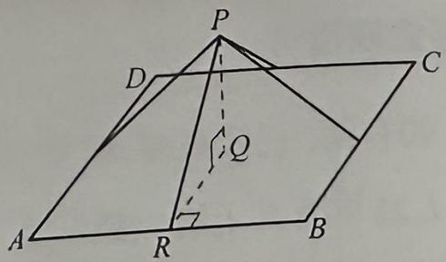

### 隨堂練習

如右圖，設 $A$ 在平面 $E$ 上的投影點為 $B$，$L$ 為平面 $E$ 上不過 $B$ 之任一直線，在平面 $E$ 上，以 $B$ 為圓心，做一圓與 $L$ 相切於 $P$ 點。試證：$\overline{AP} \perp L$。

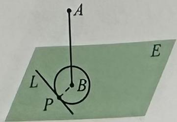

## 習題 1-1

### A 基本能力題

**1** 是非題：（正確請打「○」，錯誤請打「×」）

(1) 平面上，若兩相異直線不相交，則它們必平行。
(2) 空間中，若兩相異直線不相交，則它們必平行。
(3) 空間中，過平面外一點，恰有一直線與此平面垂直。
(4) 空間中，過直線外一點，恰有一直線與此直線垂直。
(5) 空間中，設直線 $L_1$ 在平面 $E_1$ 上，直線 $L_2$ 在平面 $E_2$ 上，若 $E_1 /\!/ E_2$，則 $L_1 /\!/ L_2$。
(6) 空間中，設 $L_1$，$L_2$ 為相異兩直線，若 $L_1$ 與 $L$ 為歪斜線，且 $L_2$ 與 $L$ 為歪斜線，則 $L_1$ 與 $L_2$ 必是歪斜線。
(7) 如右圖，已知直線 $AB$ 與平面交於 $B$ 點，直線 $BC$ 與直線 $L$ 都在平面 $E$ 上。若直線 $AB$ 垂直直線 $BC$ 於點 $B$，直線 $BC$ 垂直直線 $L$ 於點 $C$，則直線 $AC$ 垂直直線 $L$。

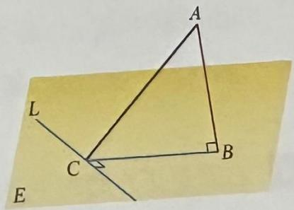

**2** 如右圖，給定一長方體，已知 $M$ 為 $\overline{AD}$ 中點，$E$ 為 $\overline{CD}$ 中點，則下列哪個選項是直線 $MN$ 與平面 $ABCD$ 的夾角？（配合課本 P.7）

(A) $\angle NMA$　(B) $\angle NMB$　(C) $\angle NMC$　(D) $\angle NMD$　(E) $\angle NME$

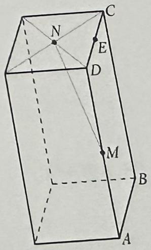

**3** 已知 $A, B, P$ 為平面 $F$ 上相異三點且 $\angle ABP = 90^\circ$，直線 $L$ 與平面 $F$ 交於 $P$ 點，且為 $F$ 的法線。如右圖，若點 $P$ 沿著直線 $L$ 移動逐漸遠離平面 $F$，則 $\angle ABP$ 的大小變化為何？（配合課本 P.12）

(A) 逐漸變大　(B) 逐漸變小　(C) 先變小再變大　(D) 先變大再變小　(E) 不變

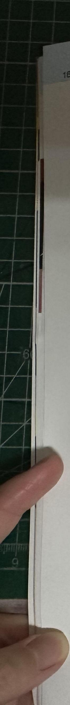

**4** 右圖是正方體的平面展開圖，關於這個正方體，請回答下列問題。（配合課本 P.4）

(1) $\overline{CH}$ 與 $\overline{AF}$ 是否互相平行？
(2) $\overline{DE}$ 與 $\overline{CF}$ 是否互為歪斜？

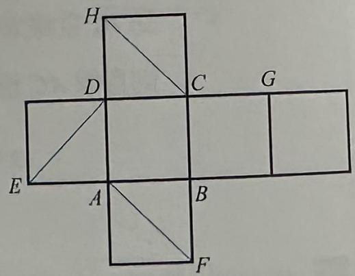

**5** 如圖，四面體 $A\text{-}BCD$ 中，$\overline{AB} = \overline{AC} = \overline{AD} = 3$，底面 $\triangle BCD$ 為邊長 2 的正三角形。若側面 $ABC$ 和底面 $BCD$ 所夾之二面角為 $\theta$，試求下列兩小題：（配合例題 3）

(1) $\cos\theta$ 的值。
(2) 利用計算機求出 $\theta$ 的近似值，並以度度量表示求至小數點後第一位。

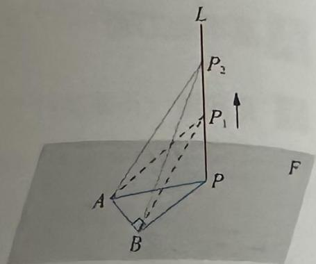

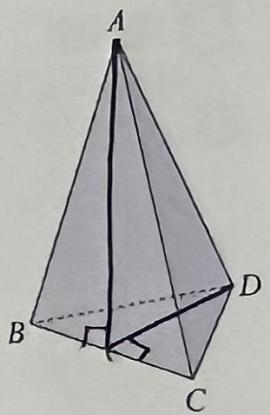

**6** 有一底面為正方形的四角錐如下圖（一），其展開圖如下圖（二），其中兩側面的三角形邊長為 3，4，5，且 $F$，$G$ 分別為 $\overline{AB}$，$\overline{CD}$ 的中點。試回答下列問題。（配合課本 P.5）

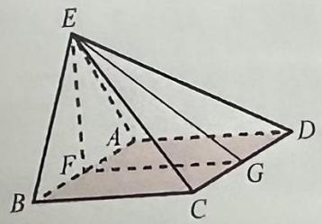
圖（一）

圖（二）

(1) 圖（一）中，$\overline{EF}$，$\overline{EG}$ 的長度等於多少？
(2) 請說明直線 $EF$ 垂直平面 $ABCD$。
(3) 試求此角錐的體積。（角錐體積 $= \frac{1}{3} \times$ 底面積 $\times$ 高）

### B 進階題

**1** 在空間中，一個斜面的「坡度」定義為斜面與水平面夾角 $\theta$ 的正切值 $\tan\theta$。如右圖，已知一金字塔（底面為一正方形，四個斜面為等腰三角形）的每一個斜面的坡度皆為 $\frac{2}{5}$，頂點 $P$ 在底面 $ABCD$ 的投影點為 $O$，斜面 $PCD$ 與底面 $ABCD$ 的銳夾角為 $\theta$ 且底面正方形的邊長為 10。

(1) 求 $\overline{PO}$ 的長。
(2) 求 $\cos\theta$ 的值。

**2** 有一平行四邊形 $ABCD$，其中 $\angle A = 60^\circ$，$\overline{AB} = 4$，$\overline{AD} = 2$，現在將此平行四邊形沿對角線 $\overline{BD}$ 對摺後豎立，使得平面 $ABD$ 與平面 $CBD$ 垂直，此時 $A$ 點被摺到 $A'$ 點，如圖所示，試回答下列各小題：

(1) 請說明直線 $A'D$ 為平面 $BCD$ 的垂線。
(2) 試求對摺後四面體 $A'BCD$ 的體積。（四面體的體積 $= \frac{1}{3} \times$ 底面積 $\times$ 高）

